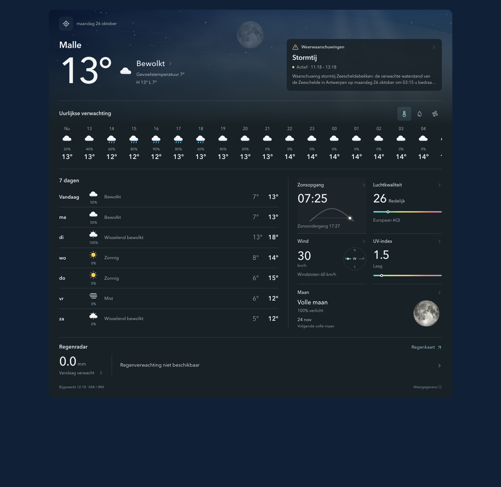

# Atmosphere Weather

A standalone Home Assistant weather integration with an animated sky and a compact, continuous forecast layout. Install **one integration**: forecasts, warnings, entities, and the card arrive together. No other weather integration or custom card is required.



## Weather features

- Animated, condition-aware skies: drifting procedural clouds, sunlight, stars, rain, and snow. Day and night follow the location's sunrise and sunset.
- Current temperature, feels-like temperature, and the day's high and low.
- Scrollable hourly forecasts with temperature, rain, and wind modes; multi-day forecasts with condition summaries, low/high temperatures, and detailed daily outlooks.
- Local **KMI / IRM warnings**, including upcoming warnings, severity, complete affected-area text, and validity windows. Warnings returned for a location can cover a broader region. Read the warning text for the affected area.
- KMI rain nowcast plus large interactive maps for observed radar, forecast rain, and wind, with local town labels, pan/zoom controls, and a location marker.
- European air quality index and pollutant details, UV, wind and gusts, humidity, dew point, visibility, and pressure.
- Locally calculated sun and moon information, NASA lunar terrain with phase lighting, illumination, moonrise/set, and the next full-moon date.
- Responsive layouts down to compact 200–240 px cards, configurable panels, keyboard-accessible details, a visual editor, Dutch and English card text, system reduced-motion support. KMI forecast/warning text supports Dutch, English, French, and German.

## Weather and event animations

Each supported weather state has at least two complementary effects. Sky motion shares one active-time clock; hidden tabs and system reduced motion stop it without catch-up. Readings stay still. The condition icon moves gently, pointer mode changes glide between selections and briefly reveal the forecast icons, and keyboard changes stay immediate.

| Weather | Effects |
| --- | --- |
| Sunny | Moving sunbeams and drifting light motes |
| Clear night | Twinkling stars and occasional shooting stars |
| Partly cloudy | Cloud parallax and moving illuminated cloud edges |
| Cloudy | Cloud parallax and a rolling cloud bank |
| Rain | Slanted rain and expanding rain ripples |
| Heavy rain | Denser, faster rain and ripples |
| Snow | Distant falling snow and larger swirling foreground flakes |
| Sleet | Rain streaks and snowflakes together |
| Thunderstorms | Branching lightning and broad cloud illumination |
| Thunderstorms with rain | Branching lightning and rain streaks |
| Fog | Moving mist ribbons and rolling low cloud |
| Windy / windy variant | Wind streams and faster gust-driven cloud parallax |
| Exceptional | Cloud parallax and wind streams |
| Hail | Falling pellets and rebounds |

Dawn adds a warm horizon bloom and rising rays; daytime adds drifting daylight and solar haze; dusk adds twilight ribbons and horizon afterglow; night adds airglow and lunar haze. Weather remains visible over the time-of-day lighting.

Special effects are driven by weather and astronomical data: sunrise/sunset within 25 minutes, a full moon at 99.5% illumination or more, a new moon at 1% or less, incoming rain within 20 minutes, active official warnings, heat at 30°C, frost at 0°C, and gusts from 50 km/h. Each gets a sky accent and a gentle cue on its related UI heading. New moon adds faint stars; it does not draw an eclipse. There are no holiday, birthday, aurora or eclipse predictions. Lightning is one low-contrast, smoothly fading cue per 15 active seconds, never a strobe.

## Install

Requires **Home Assistant 2026.10 or newer**. KMI forecast coverage is **Belgium and Luxembourg**. No API keys are needed.

### HACS

1. In HACS, open **Custom repositories**, add `https://github.com/TwilightDuck/ha-atmosphere`, and choose **Integration**.
2. Download **Atmosphere Weather** and restart Home Assistant.
3. Go to **Settings → Devices & services → Add integration → Atmosphere Weather**.
4. Enter a location name, latitude, longitude, and forecast language. The form defaults to your Home Assistant home location.
5. Edit your dashboard and add **Atmosphere Weather** from the card picker. Select its weather entity.

The integration registers its bundled card resource automatically for storage-mode dashboards. Refresh an already-open browser after installing. For YAML resources, add:

```yaml
lovelace:
  resources:
    - url: /atmosphere/atmosphere-card.js?v=1.5.2
      type: module
```

### Manual installation

Copy `custom_components/atmosphere` into your Home Assistant `custom_components` folder, restart, and follow steps 3–5 above. The released `atmosphere.zip` contains the `atmosphere` directory ready to copy.

## Card configuration

The visual editor lets you choose the location, display name, language, and visible panels. An equivalent YAML card is:

```yaml
type: custom:atmosphere-card
entity: weather.malle_weather
```

Use the actual entity created by your integration; names depend on the configured location. Optional `name` overrides the displayed place name; optional `language: nl` or `language: en` overrides card language. Without `entity`, the first loaded Atmosphere location is used. Create additional integration entries for additional locations.

Use `show` to choose panels; omitting it shows the streamlined default layout. For example:

```yaml
type: custom:atmosphere-card
entity: weather.malle_weather
show:
  - current
  - warnings
  - hourly
  - daily
  - wind
  - radar
```

The default layout keeps current conditions and warnings together, followed by hourly forecasts, a daily outlook, sun, air quality, wind, UV, and the moon. Daily expected rainfall and the rain nowcast share one radar section. Dry forecasts show a plain dry-period message. A rain curve appears only for positive amounts, with a zero-to-maximum scale in the provider’s units (KMI: mm/10min); uncertain rain without an amount is shown as a chance of rain. The standalone rain tile remains opt-in. Humidity, visibility, pressure, and feels-like details are grouped behind the current-condition button; those tiles also remain opt-in.

Supported panels are `current`, `warnings`, `hourly`, `daily`, `feels`, `sun`, `air`, `wind`, `uv`, `rain`, `radar`, `moon`, `humidity`, `visibility`, and `pressure`. Remaining panels reflow into the available space. Weather maps open directly at a local zoom level in an expanded interactive map. Observed radar, forecast precipitation, and wind have separate layers. Sky motion advances only while the card is visible, so background tabs do not accumulate a catch-up animation.

## Reusable overview card

Add **Atmosphere Overview** from Home Assistant’s card picker for a compact dashboard card. It shares the full card’s data, animations, GPS, warning details and interactive maps. Its default panels are current conditions, warnings, hourly forecasts and radar. Empty warning panels disappear automatically; active/upcoming warnings and unavailable warning feeds stay visible. Use a two-column section on a four-column Sections dashboard for a half-width overview. The visual editor lets each instance choose its own location and panels.

```yaml
type: custom:atmosphere-overview-card
entity: weather.malle_weather
grid_options:
  columns: full
  rows: auto
```

Copy [examples/overview-card.yaml](examples/overview-card.yaml) into any dashboard’s Manual card editor, or use the picker. Replace the entity with the Atmosphere weather entity for that location. The full **Atmosphere Weather** card remains available separately.

KMI UV remains preferred when provided. If KMI omits it, Atmosphere uses the nearest hourly UV index from Open-Meteo, including zero at night. Optional-source failures leave UV unavailable.

## Current device location

Tap the **⌖** button to request current-location weather; **← Back** returns to the saved location. The close button dismisses location messages or cancels a pending lookup; late results cannot reopen it. This does not change the saved integration entry or its entities.

Regular HTTPS browsers request one GPS fix using their location permission. Home Assistant Companion does not expose a documented frontend command that forces a fresh native GPS fix, so the app path reads GPS trackers linked to the **signed-in viewer's person**, never a globally fixed phone. A viewer with multiple GPS devices gets a picker. The fallback shows its source, last reported time, and accuracy. It rejects unavailable, missing, older-than-15-minute, or worse-than-250-metre app locations. Refresh the Companion app with **Exact** location enabled if its location is old; different people should use their own HA accounts and linked person records. A shared login cannot identify which physical phone is viewing the card.

Browser GPS is used when available; if it is denied or unavailable, the card offers the viewer's app trackers. No background GPS watch is started. The selected point is kept only for this open card session; backend results are cached per authenticated user for seven minutes and are not written to entities, config entries, or the recorder. Lookup sends coordinates to KMI and rounded coordinates to the optional Open-Meteo sources. Outside Belgium/Luxembourg, the card reports unsupported coverage and keeps the saved weather view.

For a full-page dashboard, place the card in a **Panel** view. It also supports native Sections sizing:

```yaml
type: custom:atmosphere-card
entity: weather.malle_weather
grid_options:
  columns: full
  rows: auto
```

## Native entities

Each location creates a device with a weather entity (daily/hourly forecast subscriptions), an active weather-warning safety binary sensor, and feels-like, European AQI, and forecast-updated sensors. Forecast arrays are fetched through an authenticated WebSocket endpoint rather than copied into recorder-heavy state attributes. Warning attributes include complete current/upcoming warning records, so you can build your own automations.

A warning sensor is **unavailable**, rather than clear, when its data fetch fails. The card marks cached data stale, retains warning text as cached evidence, and never treats a missing warning feed as an all-clear. An expired warning is removed from the card even between provider polls.

## Data and privacy

Forecasts, warnings, and radar come from the Royal Meteorological Institute of Belgium, using the `irm-kmi-api` Python library. Atmosphere does **not** depend on the separately installed IRM KMI Home Assistant integration. KMI is polled every seven minutes; optional details and air quality every 30 minutes. A radar outage does not invalidate otherwise healthy forecasts or warnings. Optional source failures leave their values unavailable.

Open-Meteo provides modelled feels-like, humidity, visibility, and dew point. CAMS ENSEMBLE through Open-Meteo provides modelled air quality; these are not measurements from a sensor at your home. Optional requests round coordinates to two decimal places. KMI requests use your configured location. Windy is loaded only when you request a map, using coordinates rounded to four decimal places. The map includes geographic labels; weather-data resolution remains the provider’s native resolution. There is no analytics or telemetry.

All sources require an internet connection. KMI's app API and remote imagery can change independently of this project. The Open-Meteo free endpoint is intended for non-commercial use and has usage limits; see [Open-Meteo terms](https://open-meteo.com/en/terms). Windy maps follow [Windy's terms](https://account.windy.com/agreements/windy-terms-of-use). Weather warnings follow the provider's geographic scope and update cadence.

## Development and validation

```sh
npm ci
npm run build
npm test
```

The eleven browser scenarios cover icon centering, smooth graph geometry, interactive map layers, and responsive rendering (including compact 240 px cards), browser GPS, per-viewer app GPS, configurable panels, focus-safe animation resume, hourly modes, detail dialogs, warning-feed outage behavior, map layer switching, map loading, reduced motion, and sparse optional data. It uses a captured public sample, not a fabricated live forecast.

For the Home Assistant feature check:

```sh
python3 -m venv .venv
.venv/bin/pip install homeassistant==2026.10.3 irm-kmi-api==1.1.1 pytest pytest-asyncio
.venv/bin/python -m pytest tests/test_integration.py -q
```

That check runs a real isolated HA config flow, registers native entities and the resource, calls native daily/hourly forecast services, simulates outages/missing radar, verifies reload/unload, and exercises a real authenticated WebSocket for temporary GPS lookups, cache reuse, coordinate validation, and rate limiting. `scripts/probe.py` is a read-only live-provider probe for the public Malle sample coordinates. `npm run preview` opens the captured sample at `http://127.0.0.1:18764/preview.html`; its snapshot date is visible in the footer and it is not a live dashboard.

## Remove or recover

Remove the card from your dashboards, then delete the Atmosphere integration entry under Devices & services. HACS can remove the downloaded integration. The shared resource is retained so that another configured location's cards keep working; if no Atmosphere entries/cards remain, remove `/atmosphere/atmosphere-card.js` under dashboard Resources. Other weather integrations are unaffected.

## Credits and license

Original implementation, released under MIT. The reference projects were [Weather Forecast Card](https://github.com/troinine/ha-weather-forecast-card), [Lunar Phase Card](https://github.com/ngocjohn/lunar-phase-card), [IRM KMI](https://github.com/jdejaegh/irm-kmi-ha), and [Windy Card](https://github.com/timmaurice/lovelace-windy-card). No source from those cards is bundled. See [THIRD_PARTY_NOTICES.md](THIRD_PARTY_NOTICES.md) for bundled SunCalc licensing and data attribution.
